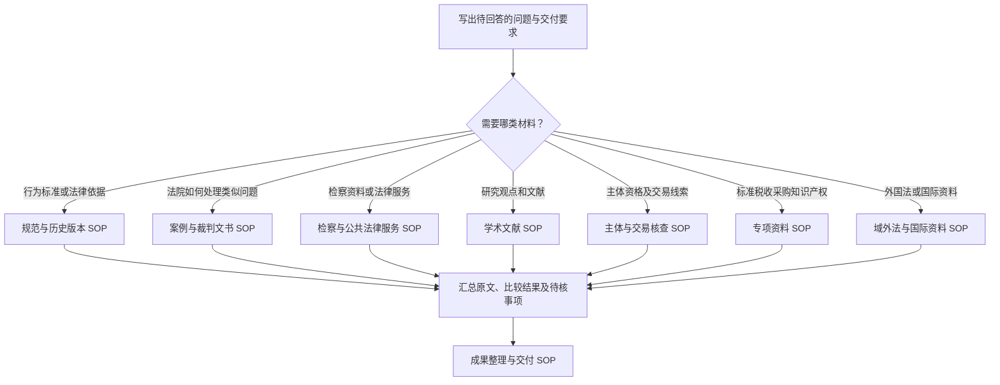

# 全书任务导航

[返回仓库首页](../../README.md) · [通用 SOP](master-sop.md) · [受阻与补查](recovery.md)

**v1.1 手动检索图谱版｜编者：余客**

从你要交付的任务进入。一个任务可能同时需要规范、案例、文献和事实资料：分别走完对应路径，再在成果整理阶段合并。本图谱沿用 v1.0 的资料分类，训练亲自找到原文、识别差异和记录判断的能力。

## 先选任务

<!-- diagram-links -->
[独立 SVG 图谱](../../diagrams/previews/index.svg) · [Mermaid 源文件](../../diagrams/sources/index.mmd)
<!-- /diagram-links -->

图中任务入口对应下表链接。阅读过程中需要资料管理、OCR 或开放项目时，另看[工具选择 SOP](sops/tools.md)。

| 我现在要做什么 | 进入的 SOP | v1.0 对应章节 | 最终应拿到什么 |
|---|---|---|---|
| 还不能明确怎么查 | [通用流程](master-sop.md) | 第一章 | 子问题、关键词组、检索记录 |
| 查行为发生时适用的规则 | [规范与历史版本](sops/norms.md) | 第二章 | 规则与版本对照、时间节点 |
| 查相似案件及不同处理 | [案例与裁判文书](sops/cases.md) | 第三章 | 候选案例比较表、相反材料 |
| 查检察公开资料、12309及服务渠道 | [检察与公共法律服务](sops/procuratorate.md) | 第四章 | 公开资料清单或办理路径 |
| 做论文选题或文献综述 | [学术文献](sops/literature.md) | 第五章 | 文献矩阵与观点分歧 |
| 核实企业等主体及交易线索 | [主体与交易核查](sops/entities.md) | 第六章 | 身份识别与事实来源表 |
| 查标准、税收、采购或知识产权材料 | [专项资料](sops/specialized.md) | 第七章 | 专题材料及其法律性质 |
| 查外国法、条约、国际裁判与仲裁材料 | [域外法与国际资料](sops/foreign.md) | 第八章 | 法域、原文、版本与后续状态 |
| 想照着做一次 | [任务演练](../walkthroughs/index.md) | 第九章 | 完整过程记录 |
| 整理报告、引用与附件 | [成果整理与交付](sops/delivery.md) | 第十章 | 可复查的报告与附件目录 |
| 选择公开项目、OCR及文献管理工具 | [工具与开放项目](sops/tools.md) | 第十一章 | 选用记录、处理副本与抽查结果 |

## 读图方法

- 矩形是动作或产物，菱形是必须回答的问题；箭头标签是分流条件。
- 一个节点完成后留下记录，再进入下一步。没有证据回答判断节点时，标记“待核”，按补查路径处理。
- “未检出”“无法访问”“无权限”“仅摘要”分别记录；检索终止可以形成带未解决事项的阶段成果。
- 决策树组织检索过程。法律适用、证据评价与争议结论在原文比较后另行论证。

## 配套表格

[检索日志](../templates/search-log.md) · [规则与历史版本](../templates/version-matrix.md) · [类案比较](../templates/case-comparison.md) · [文献矩阵](../templates/literature-matrix.md) · [检索报告](../templates/report.md) · [资源维护](../templates/resource-maintenance.md)

## 本版记录口径

图谱编制日期：2026年10月18日。资源描述以 v1.0 为基础，新增的是操作路径与记录方法；这一天不是所有平台的访问核验日期。执行者应在日志中填写实际查询日期、账号权限与页面状态。图谱源文件见 [diagrams/sources](../../diagrams/sources/)。
