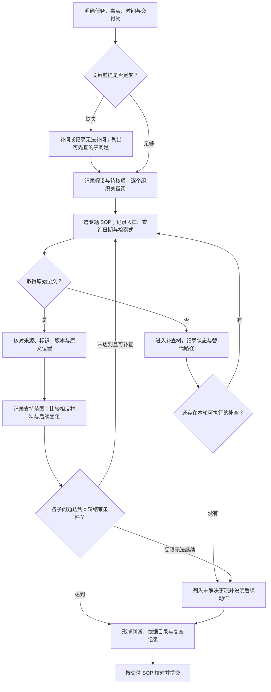

# 通用手动检索 SOP

[全书导航](index.md) · [受阻与补查](recovery.md) · [检索日志](../templates/search-log.md)

对应 v1.0 第一、九、十章。适用于从一个法律问题出发，收集规范、案例、文献或事实资料并形成可复查成果。

## 开始前填写

任务：________；用途：学习／研究／业务资料查找；截止时间：________；交付物：________。

列出已经知道的事实、尚待确认的事实、发生时间、相关地域和候选法域。用一句可回答的话写子问题，例如“签约时无书面授权，哪些事实影响代理行为的效力判断？”把结论预期与事实分开。

## 主流程

<!-- diagram-links -->
[独立 SVG 图谱](../../diagrams/previews/master-sop.svg) · [Mermaid 源文件](../../diagrams/sources/master-sop.mmd)
<!-- /diagram-links -->

## 按节点执行

| 节点 | 做什么 | 留下什么 |
|---|---|---|
| M01—M03 | 核对身份、行为、时间、地域；补问会改变检索范围的事实。可先查资料类型和制度背景，但不把未知事实写成已发生 | 任务卡、事实与假设分栏 |
| M04 | 每个子问题列概念词、事实词、同义词、排除词。先用少量核心词，再加一个条件观察变化 | 关键词表与每轮修改理由 |
| M05 | 先按材料类型找原始发布来源，聚合平台用来补充发现。记录账号可访问范围，检查字段和逻辑符帮助 | 平台、日期、字段、检索式、筛选条件 |
| M06—M08 | 用稳定标识回查原文；依结果状态进入补查树。暂不能补齐的资料保留线索，不继续循环制造“已解决”状态 | 状态、已试路径、下一动作 |
| M09 | 逐项核对标题、文号／案号、发布机关、日期、版本、全文完整性；记录直接引语位置 | 原文文件、来源链接与页码／段落 |
| M10 | 主动查反向表达、不同事实条件、后续审级与修改文件；解释材料为何一致或不同 | 支持、相反、待核三类材料 |
| M11—M14 | 对照结束条件；把每项判断与原文对应，形成报告及附件，注明哪些问题仍未解决 | 报告、依据目录、检索日志、待核清单 |

## 结束条件逐个子问题检查

1. 主要判断有可定位原文，版本、时间与地域已核对。
2. 找到的材料经过相关性比较，重要相反材料已查找并处理。
3. 新一轮检索主要重复已有材料，或继续检索所需资料、权限、事实已明确但本轮无法取得。
4. 未解决问题写明缺什么、影响哪项判断、下一步由谁在何时处理。

满足前两项且已有稳定材料，可形成已回答部分；因第三项中的限制结束时，形成阶段报告并保留第四项。**截止时间到达不自动说明检索充分。**

## 例：一轮关键词迭代

子问题“哪些事实支持代理权外观”：先查“表见代理”，识别条文用语；再分别加入“印章”“授权文件”“既往交易”；最后查“不构成表见代理”等反向表述。每轮只改少量条件，记录是扩大还是缩小范围。候选案例按事实比较，不按命中数量投票。

下一步：[选择专题](index.md)／[形成报告](sops/delivery.md)。
