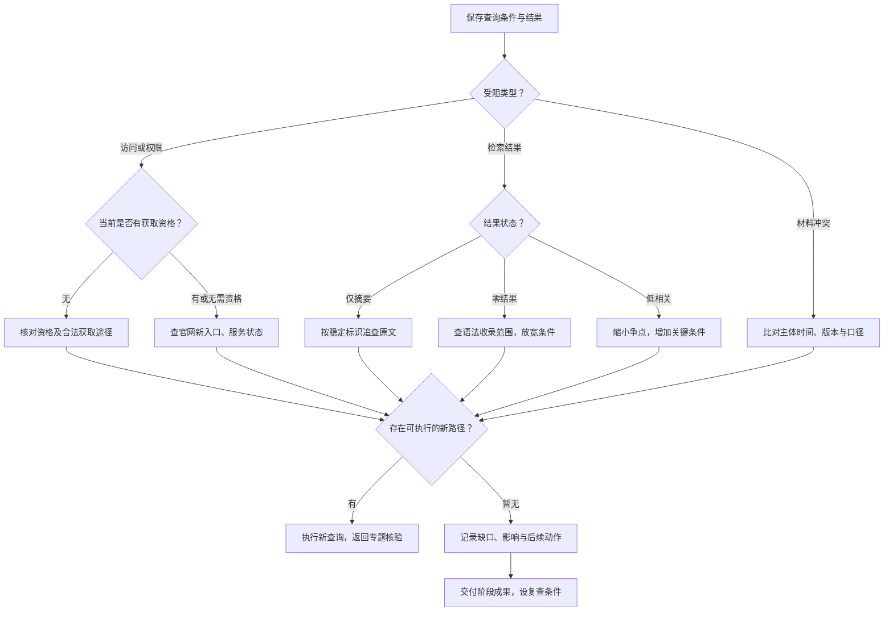

# 检索受阻与补查决策树

[全书导航](index.md) · [通用 SOP](master-sop.md) · [检索日志](../templates/search-log.md)

本树在任何专题中复用。输入是一次具体查询及其结果；先识别状态，再改变条件。每次重试记录改变了什么，保留原查询，避免无法重现。

<!-- diagram-links -->
[独立 SVG 图谱](../../diagrams/previews/recovery.svg) · [Mermaid 源文件](../../diagrams/sources/recovery.mmd)
<!-- /diagram-links -->

## 六种状态的动作与表达

| 状态 | 优先动作 | 输出表达 |
|---|---|---|
| 无法访问 | 保存时间与错误表现；由主办机关首页重新进入；确认是否迁移；不同时间复查 | “某时该入口无法访问，已查替代路径……” |
| 无权限 | 看登录、身份、机构或订阅条件；确认本人是否有资格；请求图书馆、材料提供者或相应服务支持 | “当前身份无法获取全文，已取得……，尚需……” |
| 仅摘要 | 复制完整标题、标识、机关与日期；查官方全文、附件或正式出版物 | “已发现摘要线索，以下判断尚待全文核实……” |
| 未检出 | 核对拼写、同义词、字段、年份、地域、隐名与收录范围；每次撤去或替换一类条件 | “截至某日，在所列范围与条件下未检出匹配记录” |
| 低相关 | 缩小争点，增加真正影响结果的事实条件；记录排除理由 | 候选与排除表，不用结果总量代替质量判断 |
| 冲突 | 核对是否同主体、同期间、同问题；保留不同版本或结论，解释差异 | 并列冲突材料、差异条件与待核事项 |

## 什么叫可执行的下一路径

写得出“入口／获取对象＋查询条件／所需材料＋预期解决的问题”。例如“用已知案号在承办法院官网查后续文书”可以执行；“再多找找”需要先具体化。

有明确新线索就继续；已重复同一路径而没有新条件时，改换来源或转为待核。没有固定的重试次数能够证明检索穷尽。

## 一份最小补查记录

- 任务／子问题：________
- 原查询：平台、日期、字段、检索式、权限 ________
- 状态及证据：________
- 这次改变：________；原因：________
- 新结果及原文位置：________
- 仍缺什么／影响什么判断：________
- 后续动作、负责人、触发日期或条件：________

遇到“无权限”时使用有资格的获取程序；无法取得的材料停留在待核栏。找到线索后返回所属[专题 SOP](index.md)，不要跳过原文核验。
