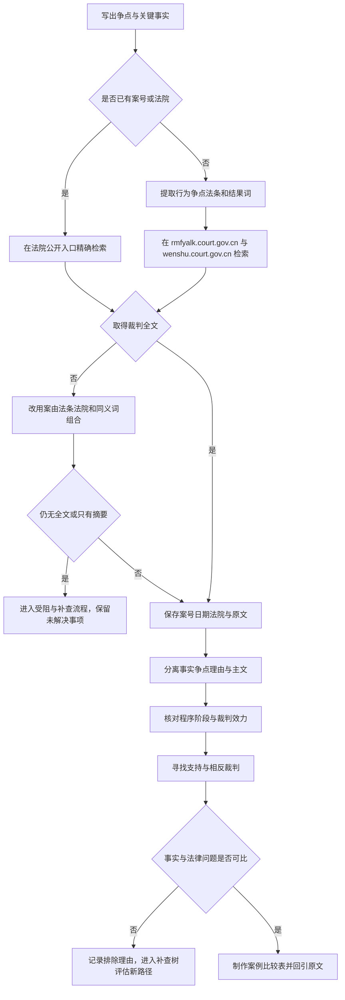

# 司法案例与裁判文书检索 SOP（CASE）

## 适用与输入

用于查找裁判文书、指导性案例、公报案例和法院公开的审判规则，适合回答“类似事实如何裁判”“某规则是否被实际适用”“是否存在相反处理”。输入至少包括争点、关键事实、程序阶段、时间范围和地域；若已有案号、法院或法条，一并记录。案例不是规范条文本身，检索结果必须回到裁判原文，区分裁判理由、当事人主张和法院最终结论。

## 决策图

<!-- diagram-links -->
[独立 SVG 图谱](../../../diagrams/previews/sop-cases.svg) · [Mermaid 源文件](../../../diagrams/sources/sop-cases.mmd)
<!-- /diagram-links -->

## 编号操作表

| 编号 | 动作/判断 | 应记录 |
|---|---|---|
| C01 | 用一句话写争点并列出决定性事实 | 争点、时间、主体、程序 |
| C02 | 判断是否已知案号或法院 | 已知线索来源 |
| C03 | 以案号、法院、日期查找原文 | 入口、检索式、日期 |
| C04 | 将事实词与争点、法条、案由拆开 | 关键词组及同义词 |
| C05 | 在法院公开入口分组检索 | 平台、筛选条件、命中数 |
| C06 | 判断是否取得完整裁判文本 | 全文/摘要/目录 |
| C07 | 调整案由、法条、法院和结果词 | 调整前后检索式 |
| C08 | 判断是否受访问、权限或收录影响 | 障碍类型与证据 |
| C10 | 保存原文并核对案号法院日期 | 文件名、网址、访问日 |
| C11 | 标记事实认定、争点、理由、主文 | 段落位置与原句 |
| C12 | 区分一审、二审、再审及公开状态 | 程序链与状态 |
| C13 | 主动搜索相反结果、不同理由和后续裁判 | 支持/相反材料 |
| C14 | 判断事实、争点、法源和程序是否相近 | 可比性四项结论 |
| C15 | 对不可比文书写明排除理由 | 排除项与回查词 |
| C16 | 用表格呈现差异并回引原文 | 案号、段落、比较结论 |

## 案例类型与法院服务另行区分

指导性案例、人民法院案例库条目、典型案例、公报案例及普通裁判文书分别标注；记录各自编号、关联案号和发布信息，按 v1.0 第3.2节回查有关参照与引述规则。案例库条目有参考价值的理由与对应裁判文书分别保存，条目摘要不能自动补足全部案情。

查法答网公开精选答问时记录问题、答复、发布来源与时间，不将其视为裁判文书。查法院公告、在线服务与本人案件进度时，先确认任务与资格；公告不自动证明最终裁判，身份服务只记录获准范围内的信息。这些任务取得所需资料或服务路径后进入交付 SOP，无需强制做类案比较。

## 异常与回流

未检出不等于没有裁判；摘要、媒体报道或数据库标签不能替代裁判原文。遇到文书打不开、仅有摘要、没有权限或案号无法核对，转入 [检索受阻与补查决策树](../recovery.md)，记录替代入口和待补材料。案例比较只说明材料之间的异同，不由决策树自动推导法律结论。

## 结束条件与成果

当核心争点已有可回查裁判原文；案号、法院、日期和程序阶段已核对；至少检查过一个相反方向或不同事实的结果；每个采用或排除的文书均有理由；新检索主要重复已有材料时结束本轮。成果包括案例清单、事实与规则比较表、支持/相反材料索引、检索记录和人工撰写的适用分析。使用 [检索记录模板](../../templates/search-log.md)、[案例比较模板](../../templates/case-comparison.md) 与 [成果报告模板](../../templates/report.md)。

## 对应内容与导航

对应 v1.0 第三章“司法案例与法院服务”及第九章“检索任务示范”。回到 [全书任务导航](../index.md) 或 [通用检索 SOP](../master-sop.md)。
