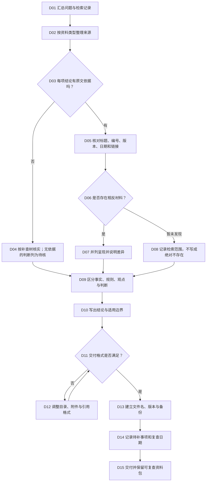

# 检索成果与资料管理 SOP（D）

## 适用与输入

适用于把一次或多次人工检索整理成可复查、可引用、可交付的成果。输入包括原始问题、已保存的来源、检索记录、未解决事项和交付对象。成果必须把事实、规范、案例、观点和个人判断分开；目录或摘要不能替代原文，法律结论仍由人依据材料作出。

## 决策树

<!-- diagram-links -->
[独立 SVG 图谱](../../../diagrams/previews/sop-delivery.svg) · [Mermaid 源文件](../../../diagrams/sources/sop-delivery.mmd)
<!-- /diagram-links -->

## 操作表

|编号|动作/判断|记录|
|---|---|---|
|D01–D02|按问题拆分子问题，再把来源分为规范、案例、文献、事实记录|问题树、来源目录|
|D03–D05|逐句检查结论与原文对应，核对标题、编号、版本、日期、链接和访问日|依据页/段、核验人、版本|
|D06–D08|主动查相反材料；未发现时只描述检索范围、关键词和截止日|相反材料、未检出记录|
|D09–D10|用不同标记区分材料内容和人的判断，写明地域、时点、事实前提|结论边界、待确认事实|
|D11–D13|按交付要求生成正文、附件、引用表，采用稳定文件名和版本号|交付清单、文件哈希/版本|
|D14–D15|列出未解决事项和复查触发条件，保存原始页面或合法副本|复查日期、资料包位置|

## 异常与回退

来源链接失效、附件过大、权限限制、团队格式不一致或发现引用错误时，按[检索受阻与补查](../recovery.md)记录并回到对应专题；不得静默删除不利材料或用新摘要覆盖旧原文。

## 结束条件与成果

每个实质性结论均有可定位依据；版本和访问日期可复查；相反材料、未检出范围和待确认事实已列明；文件结构、命名和备份完成。成果包括结论摘要、依据目录、检索日志、附件索引与复查计划，使用[检索记录模板](../../templates/search-log.md)和[成果报告模板](../../templates/report.md)。

对应章节：第10章“检索成果与资料管理”。相关导航：[全书任务导航](../index.md)｜[通用检索 SOP](../master-sop.md)。
