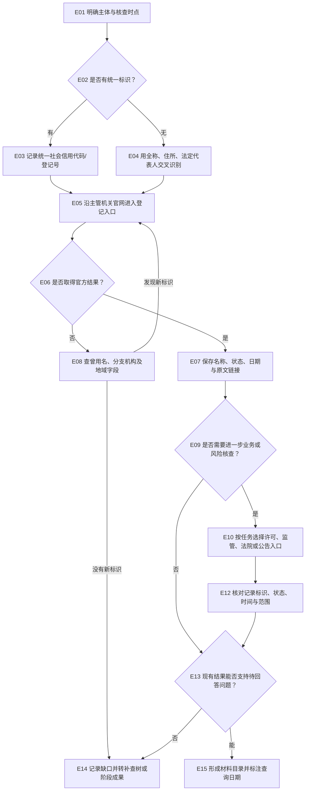

# 主体与交易信息核查 SOP（E）

## 适用与输入

适用于核对企业、机构、自然人相关的登记、许可、资质、处罚、诉讼执行及交易文件。输入至少包括主体全称、曾用名或统一社会信用代码、核查时点、所在法域和要回答的事实问题；自然人核查应先确认合法授权与必要范围。先把“主体是谁”“要证明什么”“截至哪一天”写进检索记录，避免把同名主体或不同时间状态混在一起。

## 决策树

<!-- diagram-links -->
[独立 SVG 图谱](../../../diagrams/previews/sop-entities.svg) · [Mermaid 源文件](../../../diagrams/sources/sop-entities.mmd)
<!-- /diagram-links -->

## 操作表

|编号|动作/判断|记录|
|---|---|---|
|E01–E04|锁定主体、别名、标识和时点；同名时用住所或代表人消歧|主体识别依据、授权范围|
|E05–E07|从登记机关或主管部门官网进入查询，保存页面标题、编号、状态、发布日期|官网入口、访问日期、原文链接|
|E08|结果为空时，逐项替换曾用名、简称、地域和登记号字段|尝试过的字段与检索式|
|E09–E12|只有任务确需风险记录时，才分流到许可、资质、处罚、诉讼或执行入口；逐项核对有效期和业务范围|证书/案件编号、主管机关、有效期|
|E13–E15|把结果与问题逐句对应；没有新标识或补查条件时转补查树并形成阶段成果，不能由“未查到”推断“没有”|支持关系、缺口、截止日期|

## 按任务选择材料入口

| 子任务 | 优先入口 | 核对重点 |
|---|---|---|
| 企业登记与年报 | [国家企业信用信息公示系统](https://www.gsxt.gov.cn/) | 全称、统一代码、登记变更与信息日期；年报字段与登记认定分开 |
| 社会组织或其他机构 | 相应登记主管机关的名录、公示平台 | 登记身份、业务范围、主管机关与公示时点 |
| 行政处罚与信用记录 | [信用中国](https://www.creditchina.gov.cn/)及作出决定的主管机关 | 决定书编号、主体、日期、内容及后续变化 |
| 裁判、执行与破产线索 | 法院官网、[执行信息公开网](https://zxgk.court.gov.cn/)及相应公告 | 同名消歧、案件阶段、公开范围；沿案号回查原文 |
| 证券金融与经营者集中 | 相应监管机关、交易所与市场监管机关官网 | 公告或决定类型、适用主体、报告期与后续文件 |
| 资产、许可、资质与行业信息 | 相应登记机关或业务主管平台 | 区分登记、公示、备案、许可与交易公告的作用 |
| 合同示范文本 | 主管机关公开发布栏目 | 发布机关、版本、适用场景及条款是否需要修改 |

公开记录只覆盖相应时点和范围。资产线索、备案、年报与完整权属证明分别记录，必要时补取基础交易及有资格获取的登记材料。

## 异常与回退

遇到验证码、登录、地区限制、页面失效、只有商业摘要或个人信息敏感时，按照[检索受阻与补查](../recovery.md)记录原因，改走同一主管机关的公告、年报、裁判文书或档案申请渠道；不要使用来历不明的截图替代原文。

## 结束条件与成果

主体身份已由至少一个官方标识锁定；与问题直接相关的登记、许可或案件状态均有原文、编号和日期；未公开或无法访问的项目已列为缺口。成果包括主体核查表、证据目录、待补事项和复查日期，附[检索记录模板](../../templates/search-log.md)及[成果报告模板](../../templates/report.md)。

对应章节：第6章“主体与交易信息核查”。相关导航：[全书任务导航](../index.md)｜[通用检索 SOP](../master-sop.md)。
