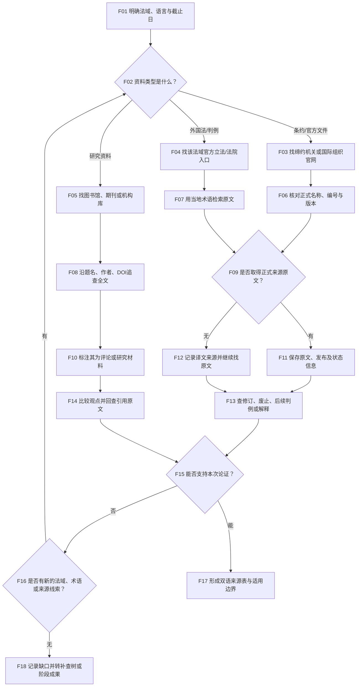

# 域外法与国际资料检索 SOP（F）

## 适用与输入

适用于外国法、国际条约、国际组织文件、域外判例和国际仲裁资料。输入应明确法域、语言、资料类型、目标日期、适用机构以及是做比较研究、争议论证还是背景说明。先区分“对相关当事国的条约状态”“外国官方文本”“国际组织文件”和“评论材料”，避免把译文或二手摘要当作法源。

## 决策树

<!-- diagram-links -->
[独立 SVG 图谱](../../../diagrams/previews/sop-foreign.svg) · [Mermaid 源文件](../../../diagrams/sources/sop-foreign.mmd)
<!-- /diagram-links -->

## 操作表

|编号|动作/判断|记录|
|---|---|---|
|F01–F02|写明法域、语言、截止日和使用目的，先做资料分类|法域清单、语言与任务|
|F03–F04|从缔约机关、国际组织或外国法院/立法机关官网进入；使用当地正式术语|官网入口、原文标题、访问日期|
|F05–F08|研究资料只作线索或解释，沿题名、作者、DOI和引文追查可核对文本|书目信息、全文链接、版本|
|F09–F12|优先保存官方语言文本；只有译文时同时记录译者、发布机构和译文日期|原文/译文对应、缺口|
|F13–F14|检查修订、废止、后续判例和权威解释；逐条回查二手文献引用|版本链、引用页码|
|F15–F18|判断材料支持的是事实、规则还是比较观点；有新线索才回到法域/术语补查，否则转补查树阶段结束|支持关系、翻译说明、结论边界|

## 按资料类型追加核验

- 条约：查保存机关或有关官方条约库的缔约状态，核对目标国家的签署、批准／加入、生效时间、保留和声明；区别作准文本与参考译文。
- 外国成文法：核对法律层级、地域、施行时间、修订记录和所需历史版本；政府公报与动态汇编的地位分别记录。
- 判例：保存法院、案号／中立引注、日期与全文；查上诉、撤销或后续引用中的区别、否定与沿用。引用次数不能自行证明效力。
- 仲裁资料：先区分裁决、程序令、机构规则和评论；核对公开文本来源与完整性，缺件按补查树处理。
- 研究文献：核对书目、页码和作者命题；引用其中的规则与案例时继续回查法源。

## 异常与回退

外文页面失效、地区封锁、只有译文、判例编号体系不熟或资料需订阅时，按[检索受阻与补查](../recovery.md)保留原检索式，改查同一机关镜像、官方公报、图书馆目录或公开机构库；必要时请具备该法域语言能力的人员复核。决策树只组织材料，不自动作出外国法解释。

## 结束条件与成果

法域和时间范围明确；拟作依据的关键规则已回查正式来源原文；仅有译文且无法核对原文的部分列为待复核；版本、后续变更和二手引用已检查；翻译和可访问限制已写明。成果为双语来源表、版本与引用对照、待复核事项，附[检索记录模板](../../templates/search-log.md)及[成果报告模板](../../templates/report.md)。

对应章节：第8章“域外法与国际资料”。相关导航：[全书任务导航](../index.md)｜[通用检索 SOP](../master-sop.md)。
