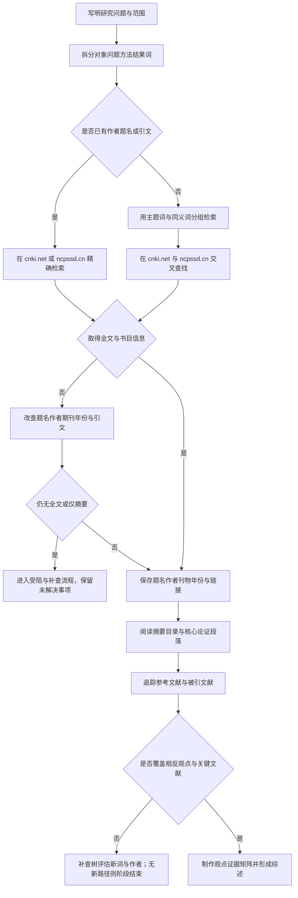

# 学术文献与研究资料检索 SOP（LIT）

## 适用与输入

用于查找法学论文、学位论文、会议资料、研究报告和引文线索，适合搭建文献综述、追踪争论和核对观点出处。输入包括研究问题、概念边界、法域、时间范围、文献类型、语言和是否需要全文。先把主题拆成“对象—问题—方法—结果”四组词，再选数据库；不要把平台的相关度排序直接当作学术重要性。

## 决策图

<!-- diagram-links -->
[独立 SVG 图谱](../../../diagrams/previews/sop-literature.svg) · [Mermaid 源文件](../../../diagrams/sources/sop-literature.mmd)
<!-- /diagram-links -->

## 编号操作表

| 编号 | 动作/判断 | 应记录 |
|---|---|---|
| L01 | 界定问题、法域、时段与文献类型 | 研究问题与排除范围 |
| L02 | 分组整理对象、问题、方法、结果词 | 关键词表与同义词 |
| L03 | 判断是否已有可验证书目信息 | 线索来源 |
| L04 | 用题名、作者、刊物、年份精确检索 | 平台、检索式、日期 |
| L05 | 将主题词分组组合并逐轮调整 | 组合式与结果变化 |
| L06 | 在 cnki.net、ncpssd.cn 交叉检索 | 平台、筛选项、命中记录 |
| L07 | 判断全文、摘要和书目信息是否齐全 | 获取状态 |
| L08 | 用作者、引文、期刊和年份追查原文 | 追查路径 |
| L09 | 判断是否仅有摘要或受权限影响 | 限制及证据 |
| L11 | 保存书目和稳定链接，不只保存搜索页 | 文件名、链接、访问日 |
| L12 | 阅读摘要、目录、方法与结论段落 | 论点、材料、限制 |
| L13 | 沿参考文献和被引关系回溯 | 关键来源链 |
| L14 | 判断是否包含相反观点和核心文献 | 覆盖判断与缺口 |
| L15 | 加入反向词、不同学派、不同年份 | 补查式与新增材料 |
| L16 | 将观点、证据、方法和可用引文对应 | 观点证据矩阵 |

## 补充图书与研究项目

图书先查图书馆目录与出版机构书目，记录作者、书名、版次、年份及ISBN；目录命中与全文获取分别记录，再按馆藏、借阅或合法获取途径取得所需页码。学位论文、工作论文与正式发表版本核对是否同一研究及内容变化。

追踪课题与团队时，查项目主管机关立项／结项公示、机构主页及公开成果；记录项目编号、负责人、机构、期间与成果关系。立项名称说明研究方向，不直接证明研究结论。

## 异常与回流

数据库无命中不等于没有研究；相关度排序也不等于质量评价。遇到仅摘要、无法下载、题名相同或书目信息冲突时，先用作者、刊物、年份和引文核对，再转入 [检索受阻与补查决策树](../recovery.md) 记录缺口。观点概括必须回到原文，不能凭摘要或二手转述写成作者结论。

## 结束条件与成果

当研究问题的核心概念已有多组检索式；关键文献均有可核对书目信息；全文或摘要限制已记录；参考文献和被引追踪已覆盖主要争论；相反观点和不同年份材料已检查；继续检索主要重复既有观点时结束。成果包括书目清单、观点证据矩阵、引文摘录、检索记录和综述提纲。使用 [检索记录模板](../../templates/search-log.md)、[文献矩阵模板](../../templates/literature-matrix.md) 与 [成果报告模板](../../templates/report.md)。

## 对应内容与导航

对应 v1.0 第五章“学术文献与研究资料”及第九章“检索任务示范”。返回 [全书任务导航](../index.md) 和 [通用检索 SOP](../master-sop.md)。
