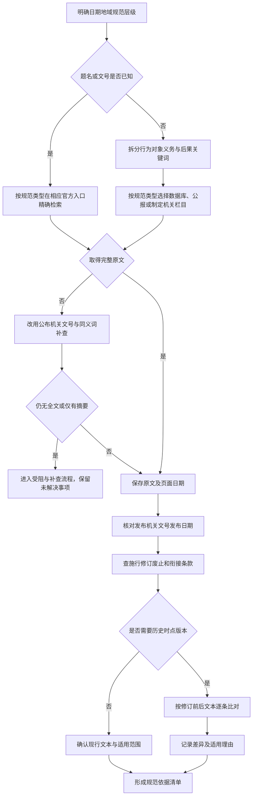

# 规范与历史版本检索 SOP（NORM）

## 适用与输入

用于确认法律、行政法规、部门规章、地方性法规、司法解释和重要政策文件的原文、公布机关、文号、施行状态及特定日期适用的版本。开始前准备：行为发生或拟发生日期、地域、主体身份、规范层级、可能的题名或关键词，以及需要交付的引用格式。先写下待回答问题，例如“2020 年 6 月某行为是否已有明确禁止条文”，再开始检索，避免把搜到的条文倒推成问题。规范类型决定入口：法律、行政法规、司法解释优先查国家法律法规数据库（flk.npc.gov.cn）及制定机关；部门规章、地方政府规章查国家规章数据库或制定机关；政策文件查政府公报、发布机关官网及其公开文件栏目。

## 决策图

<!-- diagram-links -->
[独立 SVG 图谱](../../../diagrams/previews/sop-norms.svg) · [Mermaid 源文件](../../../diagrams/sources/sop-norms.mmd)
<!-- /diagram-links -->

## 编号操作表

| 编号 | 动作/判断 | 应记录 |
|---|---|---|
| N01 | 固定日期、地域、层级与待回答问题 | 问题版本、事实日期、检索人 |
| N02 | 判断是否有题名或文号 | 已知标识及来源 |
| N03 | 用题名、文号和公布机关精确检索 | 数据库、检索式、日期 |
| N04 | 将行为、对象、义务、例外拆成词组 | 原始关键词与同义词 |
| N05 | 在 flk.npc.gov.cn 逐组检索并查看结果字段 | 命中标题、文号、链接 |
| N06 | 判断页面是否为可核对的完整原文 | 全文/摘要/目录状态 |
| N07 | 用文号、发布机关、旧题名交叉检索 | 补查式与新增入口 |
| N08 | 判断是否仍无全文或只得到转载 | 未检出或访问障碍原因 |
| N10 | 下载或保存原文并标注访问日期 | 文件名、网址、日期 |
| N11 | 对照题名、文号、公布机关、发布日期 | 四项标识核对结果 |
| N12 | 查修订、废止、施行和过渡条款 | 状态及条款位置 |
| N13 | 判断问题是否涉及历史时点 | 时点依据 |
| N14 | 逐条比对相关版本，保留变更前后原句 | 版本差异表 |
| N15 | 确认现行文本和适用对象 | 适用范围与排除项 |
| N16 | 说明为何采用某一版本 | 适用理由与待核问题 |
| N17 | 只把能回到原文的材料列入依据清单 | 条款号、页码或段落 |

## 异常与回流

未检出、无权限、页面打不开、只有摘要或转载文本时，不把空结果当成不存在，转入 [检索受阻与补查决策树](../recovery.md)。补查至少记录改过的关键词、字段、入口和日期。法律结论由人工依据原文作出，图谱只负责引导材料核对。

## 结束条件与成果

当待回答问题已有可访问原文；发布机关、文号、日期和版本已核对；相关修订、废止、衔接条款已检查；历史时点的差异已保留；继续检索只产生重复材料或已明确记录未解决事项时，可以结束本轮。成果包括：规范依据清单、版本差异表、检索记录和一段与条文逐项对应的人工分析。记录格式见 [检索记录模板](../../templates/search-log.md)、[版本比对模板](../../templates/version-matrix.md) 与 [成果报告模板](../../templates/report.md)。

## 对应内容与导航

对应 v1.0 第二章“法律法规与政策文件”及第九章“检索任务示范”。综合流程见 [全书任务导航](../index.md) 和 [通用检索 SOP](../master-sop.md)。
