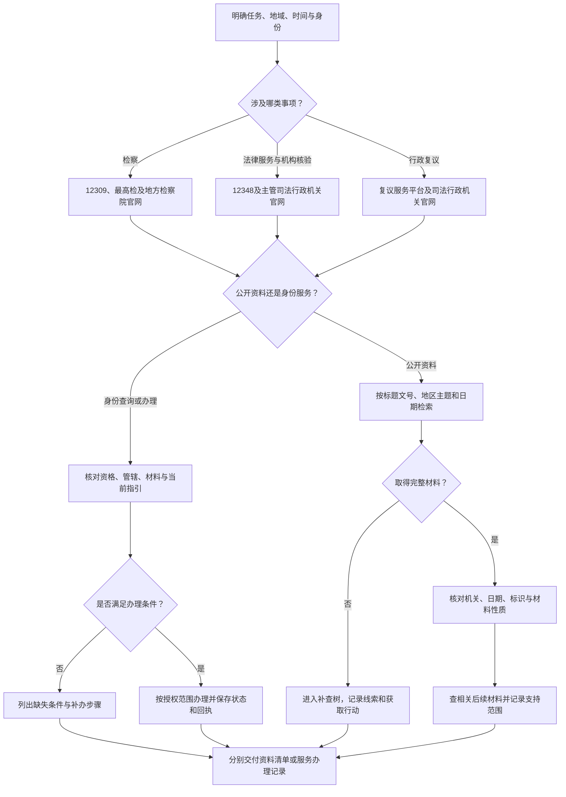

# 检察与公共法律服务检索 SOP（P）

## 适用与输入

对应 v1.0 第四章，涵盖12309检察公开资料与案件服务、12348公共法律服务、行政复议资料与服务。输入是任务类型、地域、时间、希望取得的材料和办理人身份。先确定是研究公开资料、查询特定案件，还是办理事项。

## 决策图

<!-- diagram-links -->
[独立 SVG 图谱](../../../diagrams/previews/sop-procuratorate.svg) · [Mermaid 源文件](../../../diagrams/sources/sop-procuratorate.mmd)
<!-- /diagram-links -->

## 编号操作表

| 编号 | 动作与判断 | 应记录 |
|---|---|---|
| P01—P02 | 先按任务分流。公开研究、本人案件服务、申诉提交、法律服务机构核验分别列子任务 | 目标、地区、时间、身份与所需资料 |
| P03 | 从 [12309中国检察网](https://www.12309.gov.cn/)、[最高检](https://www.spp.gov.cn/)与承办地检察院官网导航查公开栏目；个案查询与阅卷另读服务指引 | 实际栏目、查询字段、权限与获取日期 |
| P04 | 通过 [12348中国法律服务网](https://www.12348.gov.cn/)及主管机关查法律服务机构、人员和服务指南；机构核验记录名称、地区、执业状态及公示日期 | 官方名录或公示材料，疑点与补核路径 |
| P05 | [全国行政复议服务平台](https://xzfy.moj.gov.cn/)用于查服务指引并按身份使用相应功能；公开典型案例、白皮书或决定材料另查司法行政机关、政府及承办机关官网 | 原行政行为、复议机关、决定或材料类型、程序信息 |
| P06—P07 | 先用已知标题或文号，再组合主题、地区与日期；如无相应字段则分轮检索。把典型案例、听证公告、文书、新闻及工作报告分类 | 查询式、来源标识和材料性质 |
| P08—P11 | 检查本人角色、身份材料、委托权限、案件绑定、管辖和审核要求；符合条件再按指引办理，记录实际状态 | 缺失材料、后续动作、提交编号与回执 |
| P12—P13 | 仅有摘要、无权限、未检出分别进入补查树；沿稳定标识、发布机关或后续公告找原文 | 已试路径、所缺全文、阶段成果范围 |
| P14—P15 | 核对全文及附件，区分机关认定、发布者摘要和当事人主张；查询相关后续处理 | 原文位置、时间、可支持命题与待核事项 |
| P16 | 研究交资料目录；机构核验交身份和公示记录；办理任务交程序路径或办理记录 | 已解决与未解决事项、复查安排 |

## 异常与回流

进入[检索受阻与补查](../recovery.md)后，有新标识或入口才返回公开检索；暂无可执行路径时交付已核实部分并明确待办。当前身份没有阅卷权限与公众入口未检出是不同状态。听证公告、线索提交回执和程序状态各自回答不同问题，不能据此推定最终处理结果。

## 结束条件与成果

任务类型已分清；公开材料的原文与性质已核对，或缺件已列明；身份服务的办理条件和当前状态已记录；下一动作有对象和条件。成果包括公开资料清单、机构核验记录、服务路径或办理回执，按任务选用，不强制把所有渠道都查一遍。

使用[检索日志](../../templates/search-log.md)和[报告模板](../../templates/report.md)。相关：[全书导航](../index.md) · [通用 SOP](../master-sop.md) · [12309演练](../../walkthroughs/procuratorate.md)。
