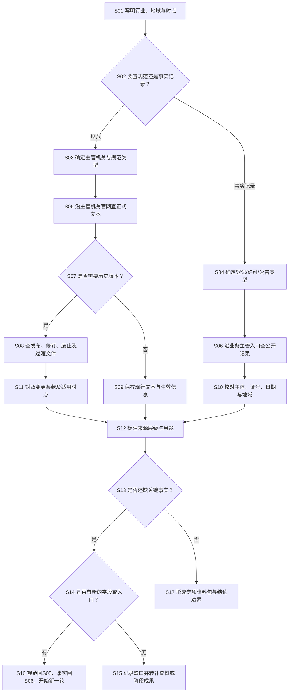

# 专项资源检索 SOP（S）

## 适用与输入

适用于标准、税收、政府采购、知识产权、建筑资质、环保等需要专门主管机关或专门数据库的任务。输入为待解决的事实问题、行业/地域、时间范围、资料类型及交付用途。先判断问题属于“规范”“登记/许可”“行政记录”还是“技术资料”，再选入口；专项名称不能代替具体问题。

## 决策树

<!-- diagram-links -->
[独立 SVG 图谱](../../../diagrams/previews/sop-specialized.svg) · [Mermaid 源文件](../../../diagrams/sources/sop-specialized.mmd)
<!-- /diagram-links -->

## 操作表

|编号|动作/判断|记录|
|---|---|---|
|S01–S04|将行业俗称改写成主管机关使用的正式术语，区分规范与事实记录|问题句、术语表、时间地域|
|S05–S06|从主管机关官网进入数据库或公告栏目，优先保存原文而非转载页面|入口路径、栏目、访问日期|
|S07–S09|涉及时点时，沿发布机关查修订令、废止公告和过渡条款|版本链、发布日期、生效日|
|S10|对登记或许可逐项核对主体、证号、状态、范围和有效期|字段截图/原文、证号|
|S11–S12|把规范效力、技术指南、行业解读分层标注，不混作同一依据|来源层级、可支持事项|
|S13–S17|对缺口先判断是否出现新的字段或入口；有则按原任务类型补查，无则转补查树并形成阶段成果|补查动作、缺口、交付边界|

## 专题入口与关键区别

| 任务 | 入口选择 | 记录与判断 |
|---|---|---|
| 国家或行业标准 | 标准主管机关的公共服务平台、正式发布机构 | 标准编号、年份、现行或废止状态、替代关系；区分强制性与推荐性，另查法规或合同是否引用 |
| 税收政策 | 税务总局及相应税务机关官网 | 文号、适用税种、期间、主体和征管口径，查失效与后续解释 |
| 政府采购 | [中国政府采购网](https://www.ccgp.gov.cn/)与地方指定平台 | 采购人、项目编号、采购阶段、变更公告、结果与投诉处理分别保存 |
| 多元解纷 | 相应法院、司法行政机关或调解组织的公开服务入口 | 区分公开案例与本人办理服务，身份要求另记 |
| 知识产权 | 国家知识产权局及有关官方检索入口 | 标识、权利人、日期、法律状态与后续程序；查询对象分专利、商标等类型 |
| 证券披露 | 交易所与指定信息披露平台 | 主体、公告类型、报告期及更正文件；公告陈述与独立核实事实分别表达 |

技术标准并非都具有相同的法律作用；“规范”分支用于查文本与版本，实际约束力还需结合标准性质、引用依据和具体任务判断。发现缺口时保留原任务类别，按图中S16回到相应入口，不将规范缺件改写为主体登记查询。

## 异常与回退

入口改版、地区库分散、全文需登录、标准只显示题名或商业库只给摘要时，按[检索受阻与补查](../recovery.md)记录并回到发布机关、地方主管部门、公开年报或正式申请渠道；不能以搜索引擎摘要代替规范原文。

## 结束条件与成果

专项类别已经确定，主管机关和适用地域明确；规范任务有正式文本及版本链，事实任务有主体和日期字段；无法公开取得的内容已标注。成果为专项检索表、资料包、引用说明和后续核验清单，附[检索记录模板](../../templates/search-log.md)及[成果报告模板](../../templates/report.md)。

对应章节：第7章“专项资源检索”。相关导航：[全书任务导航](../index.md)｜[通用检索 SOP](../master-sop.md)。
