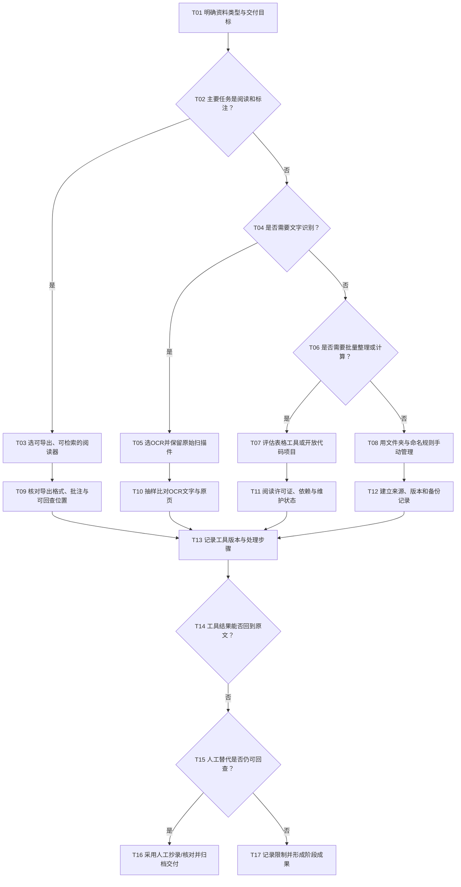

# 工具与开放项目选择 SOP（T）

## 适用与输入

适用于选择阅读器、文献管理、OCR、网页存档、表格处理和代码/开放项目等辅助工具。输入为资料格式、数量、是否需要全文检索、协作方式、隐私要求和交付格式。工具服务于手动阅读与记录，不替代原文核验。

## 决策树

<!-- diagram-links -->
[独立 SVG 图谱](../../../diagrams/previews/sop-tools.svg) · [Mermaid 源文件](../../../diagrams/sources/sop-tools.mmd)
<!-- /diagram-links -->

## 操作表

|编号|动作/判断|记录|
|---|---|---|
|T01–T04|先按阅读、识别、整理、计算分类，不因工具流行而改变任务|资料格式、数量、隐私约束|
|T03|阅读器应能全文搜索、标注并导出；保留页码或段落定位|工具名称/版本、导出文件|
|T05、T10|OCR只产生工作文本，逐页抽样比对数字、案号、否定词和表格|原扫描件、抽样页、纠错记录|
|T06–T07|批量处理前先做小样本；开放项目核对许可证、依赖、更新和输入数据去向|仓库地址、版本、许可证、运行日期|
|T08、T12|简单任务优先文件夹、稳定命名和人工索引，确保他人可复查|目录树、备份位置|
|T09、T13–T17|确认产物能回到原文并写明处理步骤；工具不可回查时判断人工替代，仍不可行则转补查树阶段结束|可回查链接、工具日志、交付文件|

## 工具与项目的具体选择

| 需要 | 候选资源 | 人工核对动作 |
|---|---|---|
| 管理文献与附件 | [Zotero](https://www.zotero.org/) | 核对导入书目、版本、页码与附件关联 |
| 扫描件可搜索 | [OCRmyPDF](https://github.com/ocrmypdf/OCRmyPDF)或适合本地条件的OCR工具 | 原图保留；抽查日期、金额、条号与否定词，拟引用段落逐字核对 |
| 阅读整理后的中文法律文本 | [LawRefBook Laws](https://github.com/LawRefBook/Laws)、[lawtext](https://lawtext.github.io/) | 用熟悉条文抽查完整性和版本，正式引用回到官方文本 |
| 发现资源 | [中文法律资源清单](https://github.com/pengxiao-song/awesome-chinese-legal-resources) | 区分官方入口、社区项目与数据集，回查上游来源 |
| 提取支持格式的法律引文 | [eyecite](https://github.com/freelawproject/eyecite) | 核对适用语种、格式与识别结果；引文提取后继续查原文与支持关系 |

技术工具安装前读项目文档与依赖，先处理少量副本；没有安装条件时使用人工索引和抄录。推荐教材与研究指南见 v1.0 第11.3—11.4节，按任务先选资料类型说明，再查具体产品帮助。

## 异常与回退

工具收费、停止维护、格式丢失、OCR误读、代码依赖无法安装、资料含敏感信息时，按[检索受阻与补查](../recovery.md)记录并改用本地离线阅读、人工抄录、官方导出或简化文件夹管理。许可不清的代码和数据不得直接用于交付；工具输出始终回查原文。

## 结束条件与成果

工具选择与任务相称；原文、处理文件和版本记录完整；OCR或批处理结果已抽样核验；许可证、隐私与可复查性得到确认；必要时已保留人工替代路径。成果为工具选择表、处理日志、原始/派生文件对照和交付包，附[检索记录模板](../../templates/search-log.md)及[成果报告模板](../../templates/report.md)。

对应章节：第11章“开放项目与延伸阅读”。相关导航：[全书任务导航](../index.md)｜[通用检索 SOP](../master-sop.md)。
