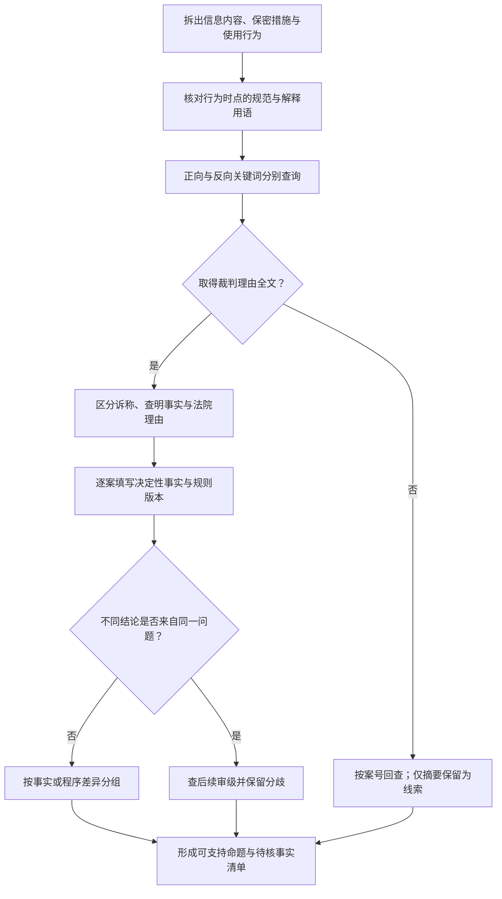

# 演练二：客户名单争议的类案比较

[演练目录](index.md) · [案例 SOP](../atlas/sops/cases.md) · [比较表](../templates/case-comparison.md)

## 任务卡（教学设定）

员工离职后开展同类业务，原单位称其使用了客户名单。需要找出法院分析客户信息保护及侵害行为时关注的事实。暂未明确名单内容、来源、保密措施、取得与使用方式。

目标交付是“争点清单＋候选案例比较表”，而非根据“带走客户”一句话直接作出侵权结论。

## 操作路径

<!-- diagram-links -->
[独立 SVG 图谱](../../diagrams/previews/example-case-comparison.svg) · [Mermaid 源文件](../../diagrams/sources/example-case-comparison.mmd)
<!-- /diagram-links -->

## 第一轮：先确定比较项

回到相应行为时间的反不正当竞争规范及有关司法解释，核对所用术语。形成以下候选检索组：

| 目的 | 候选词组 | 阅读时的问题 |
|---|---|---|
| 发现常见争点 | 客户名单；客户信息；商业秘密 | 原文究竟保护什么具体信息？ |
| 查事实条件 | 保密措施；公开渠道；交易习惯；深度信息 | 哪些事实被法院认定，证据是什么？ |
| 查取得与使用 | 离职；获取；使用；披露 | 被指行为与证据如何对应？ |
| 查相反处理 | 不构成；未采取保密措施；不能证明 | 是规则判断、事实差异，还是举证失败？ |

这些词组分轮执行；使用平台逻辑符前先查帮助。候选入口：[人民法院案例库](https://rmfyalk.court.gov.cn/)、[中国裁判文书网](https://wenshu.court.gov.cn/)、承办法院官网。访问受阻按补查树记录。

## 第二轮：比较理由，不按结论计票

下面A、B是**为练习比较而编制的情境卡，不是真实裁判，也不能作为引证材料**：

- A卡：材料描述客户名称与电话可以公开取得，尚未提供其他信息内容和管理措施。
- B卡：材料描述还包含非公开交易偏好与报价信息，并有访问控制记录；信息取得和实际使用仍需查证。

| 比较项 | A卡 | B卡 | 检索启示 |
|---|---|---|---|
| 信息内容 | 名称、电话 | 名称之外还有交易与报价信息 | 不能只按“客户名单”标签归为同一事实 |
| 公开程度 | 设定为可公开取得 | 部分设定为非公开 | 查法院如何识别具体信息的公开性 |
| 管理措施 | 尚未提供 | 有访问控制记录 | 查措施内容、覆盖范围和证明材料 |
| 取得与使用 | 未明确 | 未明确 | 两卡均不能跳过行为与证据问题 |
| 可形成的判断 | 信息内容尚需具体化 | 信息内容及管理方式不同 | 相似词语不等于决定性事实相同 |

实际查得案例后，以原文替换情境卡；填写案号、法院、日期、审级、材料类型、规则版本和理由位置。不同审级分开保存，再建立同案关系。

## 第三轮：主动找能推翻初步理解的材料

若初步认为“有保密协议即可”，就去查法院是否还要求核对具体信息、措施和其他要件；若初步认为“客户名称公开就无保护可能”，继续查争议对象是否还包含其他非公开信息。目标是修正过宽命题，而非凑足正反案例数量。

## 阶段成果示例

> 当前任务中，名单内容、公开程度、管理措施以及取得和使用行为均影响检索范围。已将这些因素列为比较项。后续案例只有在具体事实和规则版本可比时才进入同组；仅有相似案名或相同结论不足以作为类案判断依据。待补材料包括名单样本、形成与获取记录、管理制度及相关行为证据。

真实报告另附实际案例比较表。找不到全文的条目列为“线索待核”，不填写法院未被核读的裁判理由。
