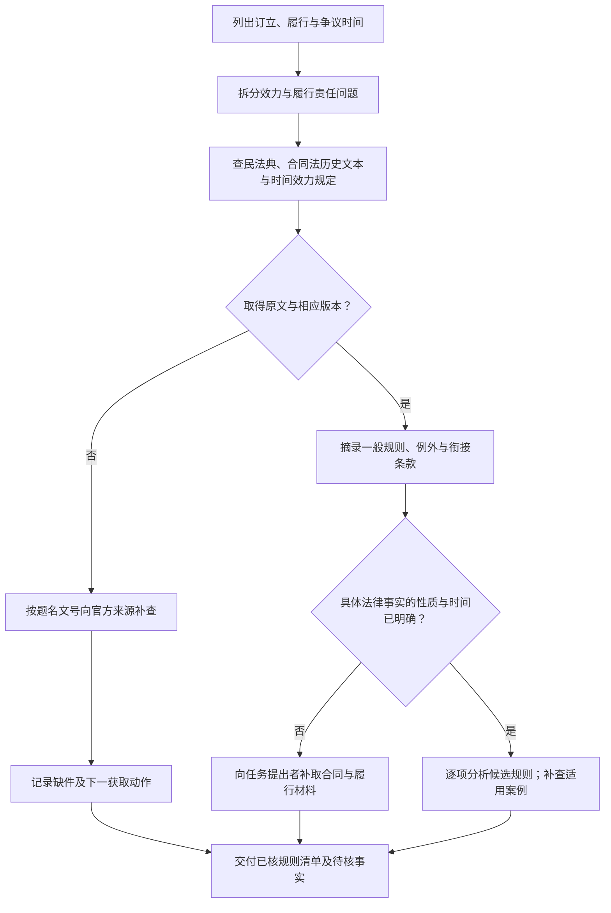

# 演练一：跨越民法典施行时间的合同问题

[演练目录](index.md) · [规范 SOP](../atlas/sops/norms.md) · [版本表](../templates/version-matrix.md)

## 任务卡（教学设定）

甲乙于2020年6月订立合同；约定的部分义务在2022年履行，之后发生争议。任务是整理分析合同效力与履行责任所需的规范资料，交付一张版本表和一页阶段报告。合同内容、争议行为和具体履行时间尚不完整。

这份输入能开展规范发现与时间分类，尚不足以确定全部实体结论。

## 操作路径

<!-- diagram-links -->
[独立 SVG 图谱](../../diagrams/previews/example-historical-law.svg) · [Mermaid 源文件](../../diagrams/sources/example-historical-law.mmd)
<!-- /diagram-links -->

## 第一步：把同一合同拆成不同问题

| 子问题 | 已知信息 | 还需什么 |
|---|---|---|
| 订立行为相关的效力问题 | 订立于2020年6月 | 合同类型、内容、签约主体与效力争点 |
| 履行责任问题 | 部分义务在2022年履行 | 义务到期日、具体违约行为、是否存在持续性法律事实 |
| 程序问题 | 只知道发生争议 | 起诉或仲裁时间、管辖与请求事项 |

每一行都需要自己的事实时间和候选规则。不能仅凭合同订立在2020年就给全案选定同一版本。

## 第二步：按稳定标识取得候选文本

在[国家法律法规数据库](https://flk.npc.gov.cn/)查《中华人民共和国民法典》与《中华人民共和国合同法》相关历史文本；在[最高人民法院官网](https://www.court.gov.cn/)按完整题名查《关于适用〈中华人民共和国民法典〉时间效力的若干规定》，以文号“法释〔2020〕15号”交叉核对。

v1.0所列官方发布入口：[时间效力规定](https://www.court.gov.cn/fabu/xiangqing/282051.html)。打开后核对发布内容、附件和实际所用版本，继续查后续修改信息。这里提供的是候选来源，不预填本次访问成功或已取得全文。

| 顺序 | 查询输入 | 核对动作 | 下一分支 |
|---|---|---|---|
| 1 | 完整法规名称 | 名称、机关、公布与施行信息 | 同名或不同版本分别保存 |
| 2 | 完整司法解释名称；再用文号 | 题名、文号、全文与日期是否相符 | 不相符回到官方检索，不借转载标题推断 |
| 3 | 已知题名＋修改／修正／废止 | 是否存在后续文本或状态变化 | 有变化则建立版本关系 |
| 4 | 具体争点＋时间效力＋相应事实词 | 有无解释同类时间结构的裁判理由 | 进入案例 SOP，不直接沿用案件结论 |

平台未提供相应字段或逻辑运算时，分轮输入并保存实际条件。

## 第三步：填写一份阶段版本表

以下填入教学任务已经明确的信息；条款栏由执行者核读后补齐，不能凭任务描述补写法律结论。

| 子问题 | 事实时间 | 候选资料 | 要从原文提取的内容 | 当前状态 |
|---|---|---|---|---|
| 订立效力 | 2020年6月 | 合同法历史文本、民法典、时间效力规定 | 效力争点对应条款；施行前事实的一般规则与例外 | 合同内容待补，具体适用待分析 |
| 履行责任 | 涉及2022年 | 民法典、相关历史规则、时间效力规定 | 对应义务、持续性事实及有关衔接规定 | 履行行为性质与日期待补 |
| 程序事项 | 未知 | 对应程序规范及其衔接规定 | 起诉／仲裁时所需的程序规则 | 程序信息待补 |

## 第四步：交付什么

阶段报告可写：

> 本轮把订立效力、履行责任和程序事项分别建表。已知订立时间为2020年6月，部分履行涉及2022年；单一订立日期不足以回答所有规则版本问题。下一步取得合同、履行节点和具体争议事项，核读候选规范及时间效力条款后逐项分析。实际取得的原文及其版本另列附件。

执行者应把“候选资料”与“已取得并核验的依据”分栏；未取得的文件不列为已核附件。结束前检查每项判断是否同时对应事实时间、规范版本及具体条款。
