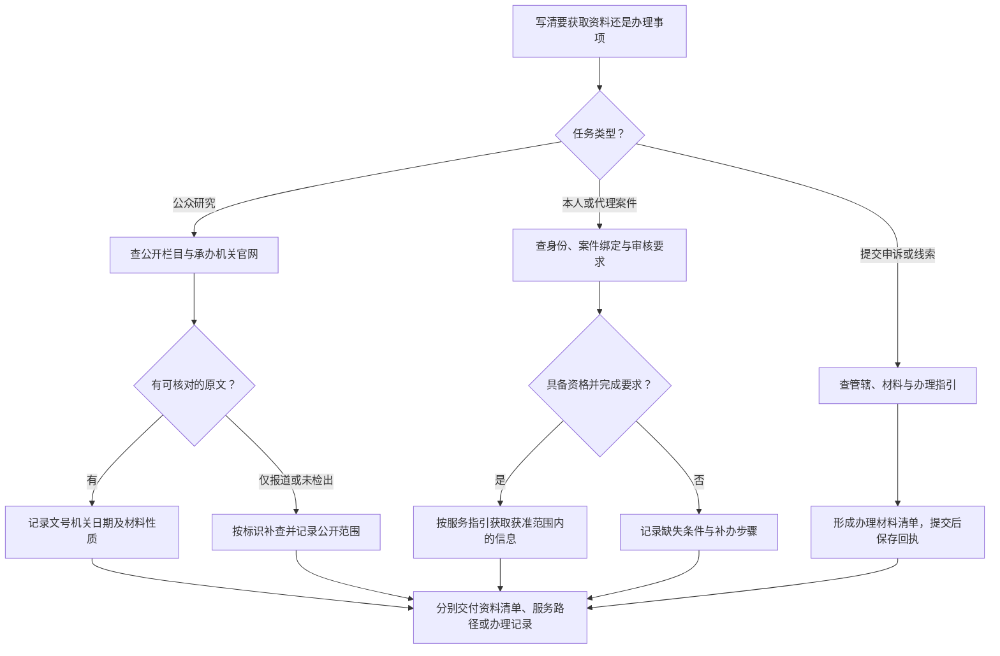

# 演练三：12309公开资料与本人案件服务分流

[演练目录](index.md) · [检察 SOP](../atlas/sops/procuratorate.md) · [检索日志](../templates/search-log.md)

## 三张任务卡（教学设定）

A：研究某地公益诉讼，想找公开发布的检察材料。
B：受托代理具体案件，想了解查询或阅卷的办理条件。
C：希望提交申诉或线索，想知道办理入口和所需材料。

同样进入12309，三个任务的路径和成果完全不同。

<!-- diagram-links -->
[独立 SVG 图谱](../../diagrams/previews/example-procuratorate.svg) · [Mermaid 源文件](../../diagrams/sources/example-procuratorate.mmd)
<!-- /diagram-links -->

## A：公开资料检索的执行表

从[12309中国检察网](https://www.12309.gov.cn/)与[最高人民检察院官网](https://www.spp.gov.cn/)导航进入相关公开栏目，再查承办地检察院官网；栏目名称和开放情况按实际页面记录。

| 步骤 | 实际做什么 | 留下什么 |
|---|---|---|
| 1 | 将地域、主题、时间分开；先查“公益诉讼＋主题”，再加入地名或年份 | 每轮条件和栏目名称 |
| 2 | 从候选条目提取标题、发布机关、日期、案号或文号（如公开） | 候选材料表 |
| 3 | 区分法律文书、听证公告、典型案例介绍、新闻和工作报告 | 资料类型及可回答的问题 |
| 4 | 有标识就追查原始全文与后续公开信息 | 原文位置、关联材料、获取日 |
| 5 | 找不到全文时，保留报道可以证实的发布事实与表述范围 | “仅摘要／未检出”等状态及后续动作 |

## B：资格服务的执行表

先核对本人角色、委托材料、身份核验、案件绑定与审核要求。依据当前办事指引列所需材料和办理状态；未完成审核时记录“当前身份未获得查询／阅卷权限”。不要将身份服务的受限状态写成“案件不存在”。

交付物示例：

| 项目 | 当前可填写的内容 |
|---|---|
| 任务 | 查明特定案件查询／阅卷服务的办理条件 |
| 角色与授权 | 由实际办理人填写并核对 |
| 尚需条件 | 按页面列明的身份、委托、绑定或审核要求逐项填入 |
| 本轮成果 | 办理路径、材料清单与待办项 |
| 后续动作 | 由有资格的办理人按指引完成手续并记录结果 |

## C：办理事项的执行表

确认事项类别和管辖；按当前指引准备材料；提交前检查接收对象与内容；提交后保存回执、编号和后续通知。平台提供提交入口，不说明事项已被受理或最终处理。

## 如何写清结果

- A任务：“在所列公开入口与条件下取得材料X、Y；Z仅有报道，后续文书待查。”仅在实际取得后填写具体标识。
- B任务：“本轮确认服务条件与待办材料；当前查询状态为……。”
- C任务：“已整理办理路径与材料；如已提交，另记提交时间、编号及回执状态。”

结束时对照原任务：研究任务交资料目录；权限服务任务交办理条件与获准范围内的信息；提交任务交办理记录。三者分别归档，不互相替代。
